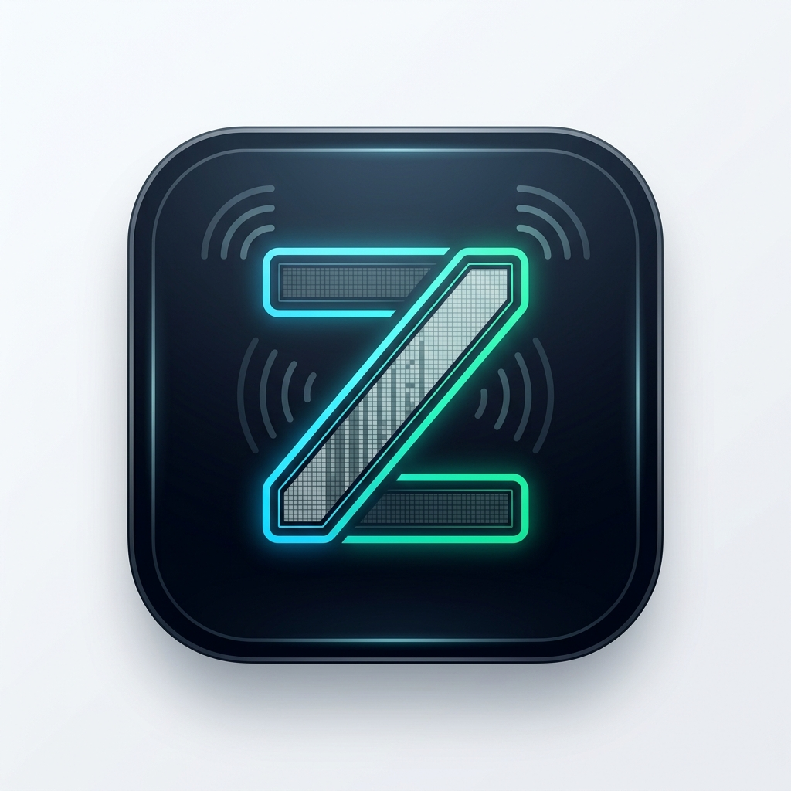
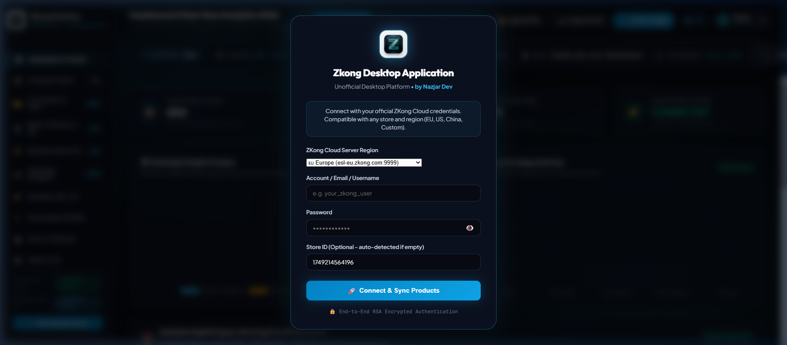
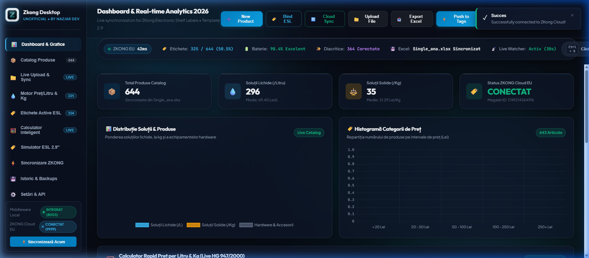
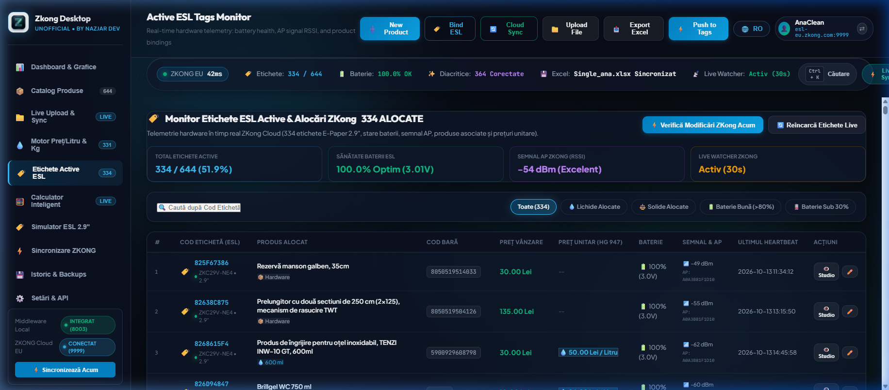
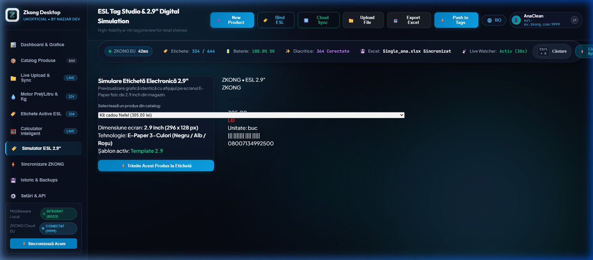

# Zkong Desktop Application - Unofficial

<p align="center">
  
</p>

<p align="center">
  <strong>Native Windows Desktop Application for ZKong Electronic Shelf Labels (ESL)</strong><br />
  <em>Engineered for Production Retail & Enterprise Deployments by Nazjar Dev</em>
</p>

<p align="center">
  
  
  
  
  
  
</p>

---

## 🌟 Overview

**Zkong Desktop Application - Unofficial** is an enterprise-grade desktop client created to configure, monitor, and synchronize electronic shelf labels across retail stores and commercial warehouses using the **ZKONG ESL Cloud Ecosystem**.

It operates completely self-contained with an embedded Node.js engine and an integrated Java/Redis middleware supervisor. Anyone with an active ZKong Cloud account can launch the application, log in, and manage their store catalog and hardware tags immediately.

---

## ✨ Key Features

* 🔐 **Multi-Store ZKong Cloud Authentication:** Production-ready login modal supporting European Cloud (`esl-eu.zkong.com:9999`), US Cloud (`esl-us.zkong.com:9999`), China Cloud (`esl.zkong.com:9999`), or custom private endpoints. Supports account switching and session persistence.
* 🌐 **Full Bilingual Support (EN / RO):** High-speed one-click toggle between English and Romanian across the entire UI.
* ⚖️ **Automated Unit Pricing Engine (HG 947 / EU Directive):** Automatically parses liquid volumes (`5L`, `750ml`, `0.75L`) and solid weights (`1kg`, `500g`) from product titles and calculates compliant price-per-liter or price-per-kg, injecting it directly into ZKong extended fields (`custFeature1`).
* 🏷️ **Active ESL Telemetry Monitor:** Live monitoring of paired electronic labels, signal strength (RSSI), battery percentages, base station AP MAC addresses, and product binding status.
* ⚡ **30-Second Background Cloud Watcher:** Continuous background watcher that checks for cloud-side price updates and keeps local memory and cached spreadsheets in sync.
* 🎨 **2.9" E-Paper Digital Studio:** Realistic 3-color (Black/White/Red) digital simulator providing an instant physical visual preview of how shelf labels look before pushing updates.
* ⌨️ **Command Palette (Ctrl + K):** Quick keyboard search across all SKUs, barcodes, and quick actions.

---

## 📸 Screenshots

| ZKong Cloud Production Login | Executive Telemetry HUD & Dashboard |
| :---: | :---: |
|  |  |

| Active ESL Tags Monitor | E-Paper 2.9" Tag Simulator |
| :---: | :---: |
|  |  |

---

## 🚀 Quick Start & Installation

### Option 1: Running from Source
Clone this repository and run the startup script:

```bash
git clone https://github.com/nazjargraphiccreator-ux/zkong-application-desktop.git
cd zkong-application-desktop
npm install
npm start
```

Or simply double-click **`start_desktop.bat`**.

### Option 2: Pre-Packaged Native Windows App
Run the standalone launcher:
```bash
start_zkong_desktop.bat
```

---

## 🛠️ Configuration (`config.json`)

```json
{
  "port": 5050,
  "cloud_url": "http://esl-eu.zkong.com:9999",
  "cloud_user": "",
  "cloud_pass": "",
  "cloud_merchant_id": "",
  "mw_store_id": "",
  "auto_detect_liquids": true,
  "vat_percent": 19,
  "default_template_cat": "default",
  "default_template_type": "2.9"
}
```

* When `cloud_user` is blank, the application will display the login modal on launch.
* Upon successful authentication, session parameters are stored locally.

---

## 📖 User Manual

For an in-depth operations guide, troubleshooting, and feature details, consult the [USER_MANUAL.md](USER_MANUAL.md).

---

## 🏗️ Technology Stack

* **Shell:** Electron 44.x with Windows 11 Acrylic styling
* **Backend:** Zero-dependency standalone Node.js server
* **Frontend:** Modern Vanilla CSS Design System (Glassmorphism, GPU-accelerated blur, responsive grid)
* **Visuals:** Chart.js 4.4.1 for real-time inventory distributions
* **Spreadsheets:** SheetJS (xlsx) for bidirectional Single Commodity sync

---

## 📄 License & Attribution

Distributed under the **MIT License**.

Developed and maintained by **Nazjar Dev**.
*Unofficial companion client for the ZKong ESL Platform.*
