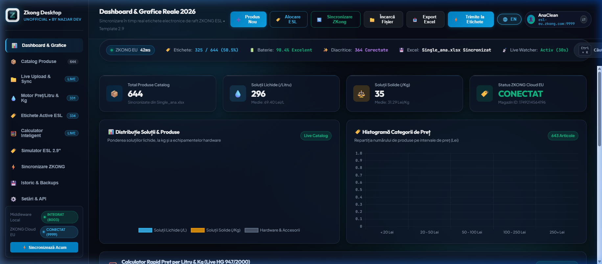

# Zkong Desktop Application - Unofficial
## Comprehensive User Manual & Operations Guide
**Developed by Nazjar Dev** • Production Multi-Tenant Desktop Edition 2026

---

## 1. System Overview

**Zkong Desktop Application - Unofficial** is a production-ready, native Windows application designed for enterprise and retail operations utilizing **ZKONG Electronic Shelf Labels (ESL)**. 

Built with zero external software requirements (no web browsers, no PHP, no Python, no XAMPP), it runs entirely self-contained with an embedded Node.js engine and an integrated Java/Redis middleware supervisor.

### Core Capabilities
* **Universal Multi-Store ZKong Cloud Login:** Compatible with any merchant account across Europe (`esl-eu.zkong.com:9999`), North America (`esl-us.zkong.com:9999`), Asia/China (`esl.zkong.com:9999`), or private on-premise servers.
* **Full Bilingual Support (EN / RO):** Seamless one-click switching between English and Romanian across all tabs, modals, tables, and telemetry HUD indicators.
* **Autonomous Unit Pricing Engine (HG 947 / EU Directive):** Automatic detection of liquid/solid volumes from product names or specifications (e.g., `5L`, `750ml`, `1kg`, `500g`) with real-time price-per-liter or price-per-kg calculation written directly into ZKong `custFeature1`.
* **Hardware Telemetry & Active ESL Monitor:** Live tracking of all bound and unbound shelf tags, battery percentages, base station AP MACs, and wireless signal RSSI.
* **30-Second Live Cloud Watcher:** Continuous autonomous background synchronization that monitors price updates on the ZKong Cloud and keeps local files and memory updated.
* **Digital ESL Studio (2.9" E-Paper Preview):** Real-time electronic ink visual rendering of promotional tags with barcode and unit pricing overlays.

---

## 2. Visual Walkthrough & Screenshots

### 2.1 Multi-Store Cloud Authentication
When launching the application for the first time, users are presented with the secure ZKong Cloud connection modal.

* **Server Region:** Select your geographic region or specify a custom IP/port.
* **Account:** Enter your official ZKong ERP account name or email.
* **Password:** Enter your credentials (protected with end-to-end RSA SPKI encryption).
* **Store ID:** Enter your store ID or leave blank for automatic detection.

---

### 2.2 Executive Dashboard & Real-Time Telemetry HUD
Once authenticated, the dashboard displays live analytics, product distribution, and the dual-border Telemetry HUD.

* **Telemetry HUD:** Displays live connection latency to ZKong Cloud, total active labels bound (e.g., 334 / 644), battery health metrics, and background watcher status.
* **Analytics Cards:** Real-time breakdown of solution categories, average unit pricing, and hardware vs. consumable ratios.

---

### 2.3 Instant Bilingual Localization (EN / RO)
Users can toggle between English and Romanian with a single click on the top-right language button (`🌐 EN | RO`).

---

### 2.4 Active ESL Tags & Telemetry Monitor
The **Active ESL Tags** view monitors every electronic paper tag paired with your base stations.

* **Health Indicators:** Color-coded battery indicators (Green > 70%, Amber 30–70%, Rose < 30%).
* **Hardware Info:** MAC addresses, Access Point signals (dBm), OEM hardware models, and last communication timestamps.
* **Quick Filters:** Filter by Bound, Unbound, Low Battery, Liquids, or Solids.

---

### 2.5 ESL 2.9" Tag Studio & E-Ink Simulator
Preview precisely how any product will appear on physical 2.9-inch 3-color (Black/White/Red) e-paper screens before transmitting changes to store shelves.

---

## 3. Getting Started

### 3.1 Installation & Startup
1. Download or extract the application package.
2. Run **`start_zkong_desktop.bat`** or open **`Zkong-Desktop-Application.exe`**.
3. The embedded server starts automatically on local port `5050` and initializes the native Electron window.

### 3.2 Logging in to ZKong Cloud
1. Select your cloud server region:
   * **Europe:** `http://esl-eu.zkong.com:9999`
   * **United States:** `http://esl-us.zkong.com:9999`
   * **China / Asia:** `http://esl.zkong.com:9999`
   * **Custom:** Enter your custom server URL.
2. Enter your account username and password.
3. Click **Connect & Sync Products**.
4. The application encrypts your password using ZKong's RSA public key (`RSA_PKCS1_PADDING`), retrieves a secure session token, and downloads your live store catalog and tag list.

### 3.3 Switching Accounts / Logging Out
* In the top-right corner of the application, locate the **User Session Profile Pill** displaying your active username.
* Click the **⇄** switch button to log out and connect to a different ZKong account or store.

---

## 4. Automated Unit Pricing Engine (HG 947 / EU Directive)

Under European Union regulations (Directive 98/6/EC) and Romanian law (HG 947/2000), products sold to consumers must display both the selling price and the unit price (per liter or per kilogram).

### How It Works:
1. **Title & Specification Parsing:** The engine analyzes incoming product names and specifications using regular expressions:
   * Liquid volumes: `5L`, `1 Litru`, `750 ml`, `0.75 L`, `5000ml`.
   * Solid weights: `1kg`, `500g`, `2.5 kg`, `250 grame`.
2. **Filtering Non-Consumables:** Accessories and non-chemical products (such as dispensers, mop heads, garbage bags, gloves, and cloths) are automatically excluded from per-liter calculations.
3. **Calculation:**
   $$\text{Unit Price} = \frac{\text{Selling Price}}{\text{Volume in Liters or Weight in Kg}}$$
4. **ZKong Extended Field Integration:** The formatted unit price (e.g., `13.40 Lei / Litru`) is automatically assigned to `custFeature1`, which maps directly to the unit price block on ZKong ESL 2.9" shelf templates.

---

## 5. Catalog Management & Live Excel Import

### Importing Products
1. Navigate to the **Live Upload & Sync** tab.
2. Drag and drop your `.xlsx`, `.xls`, or `.csv` spreadsheet onto the upload area.
3. The platform processes all items, runs the unit pricing calculator, creates a timestamped safety backup in the `backups/` directory, and syncs the changes.

### Binding an ESL Tag to a Product
1. Click **Bind ESL** in the topbar or in the catalog view.
2. Enter or scan the product barcode (e.g., `5941234567890`).
3. Enter or scan the ESL Price Tag Code (e.g., `0B72-91A4`).
4. Click **Bind in ZKong Cloud**. The association is sent immediately to the ZKong ERP server.

---

## 6. Background Live Watcher

The application features a 30-second automated watcher daemon:
* Queries ZKong Cloud for updated prices, stock adjustments, and newly bound tags.
* Detects discrepancies and synchronizes local memory and cached spreadsheets (`zkong_catalog.xlsx`) automatically.
* Visual heartbeat is displayed in the executive telemetry HUD:
  * Green **Activ (30s)** indicates continuous monitoring.
  * Clicking the Watcher HUD item triggers an immediate manual check.

---

## 7. Keyboard Shortcuts

| Shortcut | Action |
| :--- | :--- |
| **Ctrl + K** | Open 2026 Spotlight Command Palette (Instant SKU, Barcode & Action Search) |
| **F5** | Reload application interface |
| **Esc** | Close any open modal (Login, Product Editor, Command Palette) |

---

## 8. Technical Architecture

* **Frontend:** Vanilla HTML5, High-Performance Vanilla CSS (Glassmorphism, GPU-accelerated backdrop blur), Chart.js 4.4.1.
* **Backend:** Embedded Zero-Dependency Node.js Server (`http://127.0.0.1:5050`).
* **Desktop Wrapper:** Electron with Windows 11 Fluent Design & System Tray integration.
* **Security:** End-to-end RSA SPKI public key encryption for credential exchange; local token management with zero plain-text leaks.

---

*Zkong Desktop Application - Unofficial • Crafted with precision by Nazjar Dev.*
